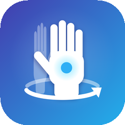
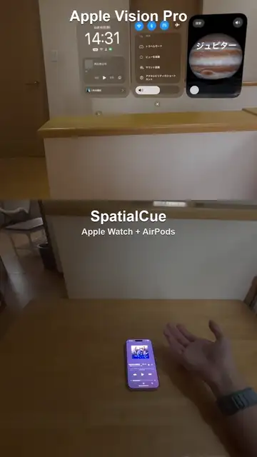

<p align="center">
  
</p>

# SpatialCue

SpatialCue brings the Apple Vision Pro "look at your hand, flip your palm" interaction to **Apple Watch motion sensors**, with optional AirPods head tracking. Without looking at a screen, you can hear the time and control the music playing on your iPhone using wrist movements and finger pinches.

<p align="center">
  <a href="docs/demo.mp4"></a>
  <br>
  <sub>Top: Apple Vision Pro. Bottom: SpatialCue on Apple Watch + AirPods. Click for the MP4.</sub>
</p>

- An Apple Watch app (gesture recognition, haptics, time) and an iPhone app (settings, music control, optional AirPods head-motion relay) work together.
- Requirements: iPhone with iOS 17 or later, Apple Watch with watchOS 11 or later. **AirPods aren't required.** Speech and music work through any headphones or the iPhone speaker.
- The UI and speech are available in English and Japanese, and you can switch them independently.

## Why I made this

SpatialCue started as a small, spur-of-the-moment idea.

After using Apple Vision Pro for a while, its "flip your palm to see the time" gesture became a habit, and I caught myself doing it even when I wasn't wearing the headset. Around the same time, I'd been thinking about wearing my Apple Watch on my right wrist, because the IC card readers on ticket gates in Japan are on the right-hand side.

Putting those two thoughts together, a Vision Pro habit and a Watch that's always on my wrist, turned into this app. It works on either wrist: the orientation is detected automatically, or you can set it in the iPhone app.

> This is a personal experiment. Gesture thresholds were tuned on synthetic data and may need adjusting on real devices.

## What it does

| Gesture | Result |
|---|---|
| Turn your palm up and look at it | A "pop" tells you it's ready |
| Flip your palm back face-down quickly | Tells the time once with haptics (Digits or Morse code) and/or speech |
| Lower your hand or break the pose while it's talking | Speech and haptics stop |
| On the clock, Double Tap | Play/pause right away |
| On the clock, flick your wrist right / left | Next / previous track |
| On the clock, turn the Digital Crown | Volume, announced every 10% |
| Make a fist or shake your head | Close |

With **Skip the menu** turned off in the iPhone app, a pinch on the clock opens a menu instead (pinch once / twice / three times for play-pause / next / previous), and pinching then moving sets the volume.

A pinch can come from any of these:
- Double Tap (Series 9 / Ultra 2 or later). While the clock is shown, a visible **Pinch** button receives it.
- **Accessibility Quick Actions** (Watch Settings → Accessibility → Quick Actions). This uses the system's double-pinch detection and is the most reliable option.
- Nodding with AirPods (when **Use head tracking** is on)
- **Experimental, off by default:** a pinch estimated from the impact on your wrist. The wrist sensors only see a small shock, so opening your hand or moving your fingers can also trigger it. If you turn it on, record pinches and "None" samples (opening your hand, moving your fingers) in **Training** on the Watch.

All settings live in the iPhone app and sync to the Watch automatically.

### Telling the time
- Choose **Vibration**, **Voice**, or **Both**. Speech can also be turned off entirely.
- Speech and the "pop" can play on the **iPhone** (speaker or any headphones; falls back to the Watch when the iPhone isn't connected) or on the **Apple Watch speaker**.
- There are two vibration patterns:
  - **Digits** (default, modeled on Apple Watch Taptic Time): long taps for the tens digit and short taps for the ones digit, hours then minutes. Uses your Watch's 12/24-hour setting.
  - **Morse code**: each digit in Morse code. Tens are strong taps, ones are light taps.
- watchOS doesn't let apps build custom haptics (no Core Haptics), so the patterns are made from the built-in haptic types. The Watch can only vibrate while its screen is on, so a long pattern can be cut short if the screen turns off.

### Safety (iPhone settings)

| Setting | Default | What it does |
|---|---|---|
| Use gestures | On | Turn off to stop all air gestures (kill switch) |
| Media controls only with headphones | Off | Media actions are ignored unless the iPhone audio output is headphones (any brand) |
| Vibration only without headphones | Off | Without headphones, no speech or sound effects; the time is conveyed by vibration |
| Ignore while arm is moving | On | Wrist impacts while swinging your arms (walking, running) aren't treated as pinches |
| Max volume | 80% | The volume never goes above this |

Headphones switch the audio output back to the speaker when you take them off, so SpatialCue treats them as worn while the output is headphones.

### AirPods (optional)
Gestures work with wrist motion alone. Turn on **Use head tracking** in the iPhone app to also use AirPods Pro / Max / 3rd generation or later head tracking: it checks that you're looking at your palm, and adds nod (select) and head shake (close).

### Controlling what's playing on the iPhone
- **Music app**: controlled with the public API (`MPMusicPlayerController`).
- **Other apps (Spotify, etc.)**: SpatialCue tries iOS's private MediaRemote framework.
  - If pausing doesn't work, it activates a non-mixable audio session so the other app gets interrupted and pauses.
  - Pinching once again ends the interruption. Whether the app resumes depends on that app.
  - This feature can be left out of the build (see **Build settings** below).

## Editions

| | Stable (TestFlight) | Full (build from source) |
|---|---|---|
| Palm gestures, time, Double Tap, flick, Digital Crown, safety settings | ✓ | ✓ |
| Music app control | ✓ | ✓ |
| Controlling other apps (private API) | – | ✓ |
| Workout mode (HealthKit) | – | ✓ |
| Extended runtime (keeps detecting for up to an hour) | – | ✓ |
| Keeping the iPhone app alive with silent audio | – | ✓ |

The stable edition leaves out features that are likely to be flagged in App Review, so it only works while SpatialCue is open on the Watch. Tip: on the Watch, set Settings → General → Return to Clock → SpatialCue to **Return to App** so it stays open when you lower your wrist.

## Installing (build from source)

iOS and watchOS apps must be signed by Apple, so you build them in Xcode on a Mac with your own Apple ID.

1. **Prepare**
   - Install Xcode 26 or later.
   - In Xcode → Settings → Components, install the **watchOS** platform.
   - In Xcode → Settings → Accounts, add your Apple ID and note your **Team ID**.
2. **Clone and create your config**
   ```bash
   git clone https://github.com/Ag3497120/SpatialCue.git
   cd SpatialCue
   cp Config/Local.example.xcconfig Config/Local.xcconfig
   ```
3. **Fill in your values**: set `SC_TEAM_ID` and `SC_BUNDLE_ID` (a unique ID such as `com.yourname.spatialcue`) in `Config/Local.xcconfig`.
4. **Run**: open `SpatialCue.xcodeproj`, choose the `SpatialCue` scheme with your paired iPhone as the destination, and run.
   - If the Watch app isn't installed automatically, run the `SpatialCueWatch` scheme with your Apple Watch as the destination.
   - Developer Mode must be on for both the iPhone and the Watch (Settings → Privacy & Security).

**With a free Apple ID**, the signature expires after 7 days and you need to build again. If signing fails for workout mode (HealthKit), clear `SC_WATCH_ENTITLEMENTS` (below).

### Build settings (`Config/Local.xcconfig`)

| Setting | Default | Purpose |
|---|---|---|
| `SC_TEAM_ID` | empty | Your Apple Developer Team ID |
| `SC_BUNDLE_ID` | `com.example.spatialcue` | iPhone app bundle ID (the Watch app appends `.watchkitapp`) |
| `SC_PRIVATE_API` | `PRIVATE_MEDIAREMOTE` | Clear to build without the private API (required for TestFlight and the App Store) |
| `SC_WATCH_ENTITLEMENTS` | `Watch/SpatialCueWatch.entitlements` | Clear to build without the workout-mode (HealthKit) entitlement |

If you change `project.yml` ([XcodeGen](https://github.com/yonaskolb/XcodeGen)), regenerate the project with `xcodegen generate`.

### First-time setup
1. On the Watch, turn on Quick Actions (Settings → Accessibility → Quick Actions).
2. Open the iPhone app and allow Music access.
3. Optional, with AirPods: turn on **Use head tracking**. Then in **Head calibration**, tap ① while looking straight ahead and ② while looking at your Watch, and tap **Calibrate palm** and look at your palm during the Watch countdown.

## FAQ

### Is it on TestFlight or the App Store?
Not yet. The features are still changing a lot, and going through TestFlight would slow down how often I can ship updates. TestFlight builds also need Apple's beta review and a build without the private API. Once things settle down, I plan to put it on TestFlight so it's easier to try.

### Does it run all the time?
watchOS doesn't let apps run in the background forever, so there are two options:
- **Default:** keeps detecting for up to an hour after you open the app.
- **Workout mode (optional):** keeps running until you turn it off. It uses more battery, and the system turns on the heart-rate sensor. Nothing is saved to Health.

In my experience workout mode drains the battery noticeably, so I use the default. I rarely go an hour without checking my Watch anyway.

## Releasing to TestFlight (maintainers)

1. Set `SC_TEAM_ID` and `SC_RELEASE_BUNDLE_ID` in `Config/Local.xcconfig`, and create the app in App Store Connect with that bundle ID.
2. Run:
   ```bash
   ./Tools/testflight.sh            # archive and export an .ipa to build/testflight
   ./Tools/testflight.sh --upload   # archive and upload to App Store Connect
   ```
   The script builds the **stable edition** (`Tools/stable-settings.sh`), and uses the date and time as the build number so every upload is unique.

## How it works

- **Wrist pose** (`Watch/Core/WristGestureDetector.swift`): derives forearm roll and elevation from the gravity vector to detect "looking at the watch face", "palm up / looking at palm", and "quick flip back".
- **Are you looking at your palm?** The positions of your AirPods and hand can't be measured. Instead, a simple body model estimates the direction of your palm as seen from your eyes, using the arm direction. The model assumes your elbow is 0.45 m below and 0.20 m in front of your eyes, and your palm is 0.33 m from the elbow. This direction is compared with the AirPods head direction, and you count as looking when the difference is within the tolerance (25° by default).
- **Audio/haptic interaction** (`Watch/Core/AirController.swift`): "pinch once" and "pinch and move" are told apart by whether your wrist moves more than 6° within 0.6 s of the pinch.
- **Pinch learning** (`Watch/Core/PinchDetector.swift`, `GestureClassifier.swift`): wrist impacts are cut into 0.5 s windows (100 Hz × 6 channels). These are classified as pinch / fist / none with 36 features and k-nearest neighbors. Training finishes on the Watch itself.
- **AirPods, optional** (`iOS/PhoneHub.swift`): with head tracking on, the iPhone reads head motion and relays it to the Watch at 15 Hz. Nods and head shakes are also used as input.
- **Staying in the background**: either **workout mode** (`HKWorkoutSession`; runs until you stop it and saves nothing to Health) or an extended runtime session (up to 1 hour). With your arm down for 3 seconds, sampling drops from 100 Hz to 25 Hz. The magnetometer and GPS are not used.
- **Localization** (`Shared/Localization.swift`): strings are written inline as `tr("日本語", "English")` so the language can be switched inside the app.

## Tests

The gesture detection and the interaction state machine can be tested on a Mac with synthetic motion data.

```bash
./Tests/run.sh
```

## Limitations
- Hand position in space (XYZ) isn't available, only angles and motion waveforms.
- Controlling apps other than Music relies on a private API and may not work on every iOS version.
- System volume is changed by moving a hidden `MPVolumeView` on the iPhone, which may not work while the iPhone app is in the background.
- AirPods yaw drifts over time, so the left/right part of gaze detection may need recalibration.
- In workout mode, the system turns on the heart-rate sensor.

## Privacy

SpatialCue collects no personal data. See [PRIVACY.md](PRIVACY.md).

## License

[MIT](LICENSE)

## Trademarks

Apple, Apple Watch, AirPods, iPhone, and Apple Vision Pro are trademarks of Apple Inc. This project is not affiliated with Apple Inc.
